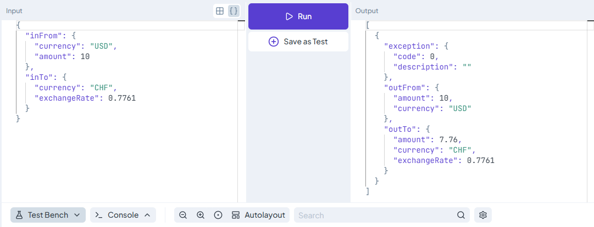
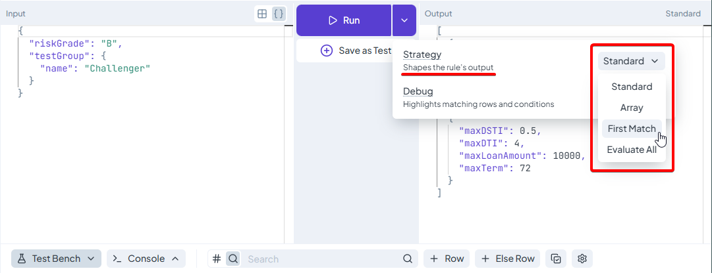

# Evaluating Rules

Once you have created a rule, you can evaluate it with different inputs to see what decisions it produces. The **solver** is the engine that executes your rule’s logic and returns the result.

You can run rules directly in DecisionRules using **Test Bench**, verify them with saved **Tests**, or call them from your application through the **Rule Solver API**.

## From Input to Output

Imagine a Decision Table that selects insurance packages based on a traveller’s age and destination.

The evaluation follows three steps:

1. You provide the traveller’s details as input.
2. The solver evaluates the conditions and calculations defined in the rule.
3. The rule returns the applicable insurance packages as output.

The input stays the same whether you enter it in Test Bench or send it from your application. The way you submit it is different.

## Try Your Rule in Test Bench

Open a rule in the Designer and expand **Test Bench** from the bottom bar.

<figure><figcaption><p>Enter input in JSON Bench and select <strong>Run</strong> to view the rule’s output.</p></figcaption></figure>

Enter your input on the left and select **Run**. The result appears on the right, together with the execution time.

You can work in two modes:

* **Simple Bench** presents input and output as individual fields.
* **JSON Bench** lets you enter and inspect complete JSON structures. Use it for nested objects or arrays of objects.

Try several scenarios. For the insurance example, change the traveller’s age or destination and check that the returned packages follow your policy. Include boundary values and cases where no package should apply.

For Decision Tables and Decision Trees, enable **Debug** to inspect which conditions matched and which rows or branches were evaluated.

_For a detailed walkthrough, see_ [_Test Bench_](https://docs.decisionrules.io/doc/rules/common-rule-features/test-bench)_._

## Choose an Execution Strategy

An execution strategy controls how supported rule types produce their results. You can select it in Test Bench or specify it in an API request.

<figure><figcaption><p>Open the dropdown next to <strong>Run</strong> to choose an execution strategy: <strong>Standard</strong>, <strong>Array</strong>, <strong>First Match</strong>, or <strong>Evaluate All</strong>.</p></figcaption></figure>

For a Decision Table, suppose two rows match the same traveller:

| Strategy         | Result                                                                                 |
| ---------------- | -------------------------------------------------------------------------------------- |
| **Standard**     | Returns the outputs of both matching rows, in table order.                             |
| **First Match**  | Returns only the first matching row. Row order determines its priority.                |
| **Array**        | Combines matching outputs into one object, with arrays of values in its output fields. |
| **Evaluate All** | Returns a result for every row, with a `_match` field showing whether it matched.      |

Choose the strategy that reflects your business decision. If the table should offer every eligible insurance package, use **Standard**. If it should select one package according to priority, use **First Match**.

Available strategies depend on the rule type. Lookup Tables, for example, offer **Lookup Value** to retrieve a record and **Lookup Exists** to check whether it exists.

_See_ [_Execution Strategy_](https://docs.decisionrules.io/doc/rules/common-rule-features/execution-strategy) _for supported strategies and examples._

## Choose a Solver

DecisionRules supports two solver engines: **AERO (v2)** and **GAIA (v1)**. AERO is the current engine, where new solver features are released. It is available from server version **1.27.0**.

The solver version is separate from the version of your rule. You can run the same rule version on different supported solver engines without creating or rewriting the rule.

In **Space Settings**, choose which solver versions are available when working in the application. With both enabled, you can select a solver for each run in Test Bench or Tests.


**Your application chooses its solver separately.** Changing Space Settings or the solver selected in Test Bench does not switch an existing API integration.


### Introducing AERO

See how to enable AERO, verify your rules on both engines, and switch your integration to v2 for faster execution without changing your business logic.



The walkthrough uses a travel insurance application. It compares the same tests on GAIA and AERO, updates the integration endpoint, and checks the resulting executions in Audit Logs.


**Solver exceptions:** Rule Flows and AI Agents always run on GAIA (v1), whichever solver version you select. See the [documented exceptions](https://docs.decisionrules.io/doc/api/rule-solver-api/rule-solver-api#exceptions).


## Verify Results with Saved Tests

Test Bench is useful for exploring individual inputs. Saved **Tests** let you repeat those checks after changing a rule or switching solver engines.

Once you have reviewed a Test Bench result and confirmed that it is correct:

1. Select **Save as Test**.
2. Choose a Test Suite and enter a test name.
3. Save the test.

The test stores the input, expected output, and execution strategy. A test does not store a solver version; you choose the solver when running it.

Before moving an existing integration to AERO, run your saved scenarios on both engines. Compare the results using the same rule version, inputs, and strategies. Investigate unexpected differences before switching the integration.

_See_ [_Rule Testing_](https://docs.decisionrules.io/doc/rules/common-rule-features/rule-testing) _for creating tests and reviewing results._

## Run Rules from Your Application

Your application can send input to the **Rule Solver API** and receive the decision in the same response.

Open **Integrations → Code Samples** in your rule to generate an example call. To use AERO, the request targets the v2 endpoint:

```http
POST https://api.decisionrules.io/rule/v2/solve/{ruleId}/{ruleVersion}
Authorization: Bearer <SOLVER_API_KEY>
Content-Type: application/json
```

The request body wraps your input in `data`. For an insurance rule whose input model contains `traveller`, an example could be:

```json
{
  "data": {
    "traveller": {
      "age": 35,
      "destination": "Europe"
    }
  }
}
```

In **Test Bench**, enter the input object itself, without the `data` wrapper. Your I/O Model should also describe the input fields themselves.

The endpoint selects the solver version. The optional `{ruleVersion}` selects the version of your business rule; if omitted, the latest published rule version is used.

For long-running asynchronous processes, use an **Integration Flow** with the **Jobs API**. The job returns an identifier so you can retrieve its results later.

_For request details, see_ [_Rule Solver API AERO (v2)_](https://docs.decisionrules.io/doc/api/rule-solver-api/rule-solver-api)_. For an existing integration, follow_ [_Rule Solver API Migration_](https://docs.decisionrules.io/doc/api/rule-solver-api/solver-version-migration)_._

## Review Executions in Audit Logs

When audit logging is enabled, each rule execution is saved in **Intelligence → Audit Logs**. You can inspect its input, output, solver version, and execution time. This is useful for checking that your application returns the expected decisions and reviewing executions before and after switching to AERO.
